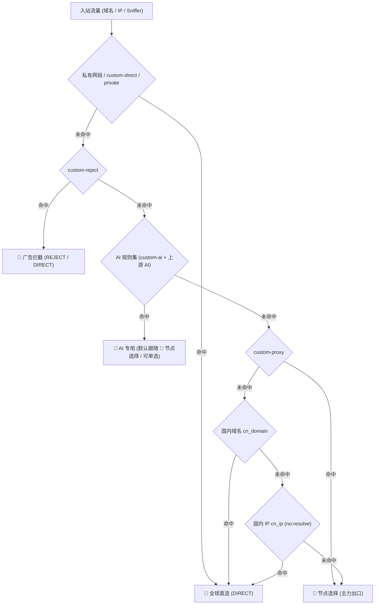

# Proxy Ruleset 工程架构文档

本文档定义了 `proxy-ruleset` 仓库的整体架构、目录规范、双端适配方案、防泄露 DNS 与路由机制，以及自动化构建流水线。

---

## 1. 设计目标与核心原则

1. **换配置零折腾（Drop-in Override）**
   - 更换新机场订阅或 Clash 配置时，无需手动修改复杂的分流与 DNS 配置。
   - **Mihomo 端（Clash Party / FlClash）**：通过一次导入远程 JS 覆写脚本并设为全局启用，新订阅自动接管 `dns`、`sniffer`、`proxy-groups`、`rule-providers` 与 `rules`，同时保留原订阅的节点列表和剩余流量/到期时间显示。
   - **Shadowrocket 端（iOS 小火箭）**：利用小火箭「订阅节点」与「`.conf` 配置」天然分离的特性，挂载一份远程 `shadowrocket.conf`，换任何新订阅均通过正则自动归类节点并复用同一套规则与防泄露 DNS。
2. **防代理与 DNS 泄露（Leak-Free by Default）**
   - 默认通过 `ipleak.net`、`dnsleaktest.com`、`browserleaks.com` 等常见代理与 DNS 泄露检测。
   - 严格隔离国内/海外 DNS 查询路径，关闭容易导致直出泄露的 IPv6 默认解析，启用域名嗅探（Sniffer）与 `no-resolve` 保护。
3. **单一规则源，双端自动编译（Single Source of Truth）**
   - 人工只维护一份清晰可读的规则源文件与外部源清单，由 GitHub Actions 自动构建两套最优产物并发布至 `dist` 分支：
     - **Mihomo 端**：二进制 `.mrs` 规则集（体积小、毫秒级加载、低内存）。
     - **Shadowrocket 端**：精简去重后的纯文本 `.list` 规则集（适配 iOS Network Extension 低内存限制）。
4. **极简有效的策略组（Anti-Bloat Policy Groups）**
   - 拒绝动辄二三十个冗余分组的模板设计，只保留真正有**差异化出口需求**的策略组（详见第 4 节）。
5. **公开仓库安全边界**
   - 本仓库托管于公网 GitHub（便于通过 GitHub Raw / jsDelivr CDN 高速拉取），**严禁提交任何机场订阅链接、自建节点 IP/UUID/密钥或敏感内网拓扑**。

---

## 2. 目标客户端与双端差异矩阵

| 维度 | 桌面端 / 安卓端（Mihomo 内核） | 移动端（iOS 小火箭） |
| :--- | :--- | :--- |
| **推荐客户端** | **Clash Party**（macOS / Windows / Linux）<br>**FlClash**（Android / 桌面全平台）<br>**Clash Meta for Android (CMFA)**（Android） | **Shadowrocket**（iOS） |
| **接入方式** | 远程 JS 全局覆写 `mihomo-override.js`（及备用 `mihomo-base.yaml`） | 远程配置文件 `shadowrocket.conf` |
| **规则集格式** | 二进制 `.mrs`（`domain` / `ipcidr`）为主，少量 `classical` | 纯文本 `.list`（Surge/Shadowrocket 语法） |
| **DNS 防泄露核心** | `fake-ip` + `respect-rules: true` + `nameserver-policy` + 代理 DoH | `[General]` 禁用系统直连回落 + DoH + `ipv6 = false` + `no-resolve` |
| **订阅流量提示保留** | JS 过滤假节点不进测速组，但保留订阅信息展示 | 订阅与 `.conf` 分离，原生保留 |

---

## 3. 工程目录结构

```text
proxy-ruleset/
├── ARCHITECTURE.md                 # 架构设计文档（本文件）
├── README.md                       # 快速接入指南、CDN 链接与测漏自检步骤
├── sources.yaml                    # 外部上游规则源清单（定义直引 .mrs 与待合并规则源）
│
├── rules/                          # 【单一规则源】人工维护的纯文本静态规则
│   ├── custom-direct.list          # 自定义强制直连域名（网银、NAS、误判国内服务等）
│   ├── custom-direct-ip.list       # 自定义强制直连 IP/CIDR（局域网、私有网段补充）
│   ├── custom-proxy.list           # 自定义强制代理域名（测漏站、易误判境外站、开发工具）
│   ├── custom-ai.list              # AI 服务补充域名（补充上游未及时收录的新域名）
│   └── custom-reject.list          # 自定义拦截域名（广告/遥测/恶意追踪）
│
├── scripts/                        # 构建、校验与转换工具链
│   └── build.py                    # 规则清洗、冲突检查、去重合并、调用 mihomo 编译 .mrs 与生成 .list/.conf
│
├── override/                       # Mihomo 端入口脚本
│   └── mihomo-override.js          # Clash Party / FlClash 通用全局 JS 覆写脚本
│
├── templates/                      # 静态/通用配置模板（供构建渲染与备用客户端使用）
│   ├── mihomo-base.yaml            # 通用 Mihomo YAML 模板（单行替换订阅 URL 备用）
│   └── shadowrocket.conf           # Shadowrocket 完整基础配置模板
│
└── .github/
    └── workflows/
        └── build.yml               # CI/CD：语法/冲突校验、定时拉取上游构建并推送至 dist 分支
```

> **分支策略**：
> - `master` 分支：仅保存源码、规则源文件、模板与构建脚本，保持历史清晰。
> - `dist` 分支（由 GitHub Actions 自动强制更新）：存放最终编译好的 `mihomo/*.mrs`、`shadowrocket/*.list`、渲染后的 `shadowrocket.conf` 与 `mihomo-override.js`，供客户端通过 jsDelivr CDN 或 GitHub Raw 拉取。

---

## 4. 策略组精简哲学与拓扑设计

代理内核本身**不会**“智能识别某个分组适合什么线路”，策略组本质上只是**路由出口的选择器**。同时，为了真正做到**对所有订阅和所有用户通用**，本工程坚持**「零节点命名假设（Zero Node-Name Assumptions）」**：

- 不写死任何节点或地区筛选正则（避免因不同机场命名习惯不同导致漏节点或空组报错）。
- 不内置后台 `url-test` 定时自动切换（避免 IP 频繁跳变触发风控及移动端额外耗电）。
- 全量有效节点动态注入策略组，只在存在**刚需差异化出口**时拆分分组：

| 策略组 | 类型 | 存在的真实理由 |
| :--- | :--- | :--- |
| `🚀 节点选择` | `select` | **绝对主力出口**。承载 GitHub、Telegram、Google、流媒体及所有未知流量；动态加载全部有效节点，手动点选即记住。 |
| `🤖 AI 专用` | `select` | **唯一强刚需业务分组**。默认第 1 项跟随 `🚀 节点选择`（零负担开箱即用），同时展开全部有效节点，方便在主力用香港时单独为 OpenAI / Claude / Gemini 指定非港节点。 |
| `🎯 全球直连` | `select` | 明确映射 `DIRECT`，便于在面板/日志中直观排查直连命中情况。 |
| `🛑 广告拦截` | `select` | 默认 `REJECT`，提供 `DIRECT` 备选，方便某个网站被规则误杀时在界面一键临时放行而无需改规则文件。 |

> **Shadowrocket 端的对应简化**：小火箭本身在首页即可直接切换全局主力节点（内置 `PROXY`），因此 `.conf` 仅需额外定义 `🤖 AI 专用 = select, PROXY, policy-regex-filter=.*` 与 `🛑 广告拦截 = select, REJECT, DIRECT`，同样做到零节点命名依赖。

### 策略与流量路由拓扑



---

## 5. 规则分层与自动化构建流水线

### 5.1 三层规则体系

1. **L1 — 本地静态规则（`rules/*.list`）**
   - 采用统一、易读的行格式编写（每行一条规则或域名，支持 `#` 注释）。
   - 拥有最高匹配优先级，用于快速修复“误杀直连”或“漏网代理”。
2. **L2 — 外部规则引用与聚合（`sources.yaml`）**
   - 支持两种模式：
     - **直引模式**：直接在配置中引用高质量上游 `.mrs`（无需本仓库重复编译）。
     - **聚合编译模式**：由 `scripts/build.py` 拉取指定的外部轻量规则集，与 L1 本地规则去重合并后再编译输出，减少客户端维护的 provider 数量。
3. **L3 — 上游基础大库（直引 `.mrs`）**
   - 直接引用 `MetaCubeX/meta-rules-dat@meta` 分支每日构建的原生 `.mrs`（`private`、`cn`、`category-ai-!cn`、`geoip/cn`）。
   - Shadowrocket 端不拉取十万级全量文本域名/IP 表，而是使用精简 `.list` + 本地内置 `GEOIP,CN,DIRECT,no-resolve`，避免 iOS 内存超限。

### 5.2 构建流水线（`scripts/build.py` + GitHub Actions）

触发条件：**Push 到 `master`**、**PR 校验**、**每日定时（Cron）** 或 **手动触发**。

1. **校验与冲突检测**：
   - 检查规则语法合法性（区分 `domain`、`ipcidr`、`classical` 语法规范）。
   - 检测同一条规则是否同时出现在 `custom-direct` 与 `custom-proxy`/`custom-reject` 中，发现冲突直接阻断构建并报错。
2. **拉取与合并去重**：
   - 按 `sources.yaml` 拉取待合并的外部规则并做格式归一化与去重。
3. **双端编译输出**：
   - **Mihomo 产物**：下载对应架构的 `mihomo` 二进制，调用 `mihomo convert-ruleset` 将文本源编译为 `.mrs`（`dist/mihomo/*.mrs`）。
   - **Shadowrocket 产物**：转换为纯文本 `.list`（`dist/shadowrocket/*.list`），注入并校验 `shadowrocket.conf`。
4. **语法验证与发布**：
   - 对 `override/mihomo-override.js` 做语法检查，对生成的 YAML/INI 做结构校验，最终推送产物至 `dist` 分支。

---

## 6. 防泄露 DNS 与路由核心设计

### 6.1 Mihomo 端防泄露机制

- **工作模式**：`enhanced-mode: fake-ip`（`fake-ip-range: 198.18.0.1/16`），客户端本地拿假 IP，真实海外 DNS 解析完全在内核与代理侧完成。
- **规则联动**：`respect-rules: true`，让 DNS 解析严格遵循路由规则与 `rule-providers`。
- **IPv6 防护**：默认 `dns.ipv6: false`（与 `tun` 侧统一控制），避免本地原生 IPv6 绕过代理直连泄露。
- **四层 Nameserver 隔离**：
  1. `default-nameserver`：仅纯 IP（`223.5.5.5`, `119.29.29.29`），专用于引导解析 DoH 域名自身。
  2. `proxy-server-nameserver`：国内加密 DoH，专用于解析机场节点域名，防止启动时循环依赖代理。
  3. `direct-nameserver`：国内加密 DoH，供命中直连规则的域名使用。
  4. `nameserver`：境外加密 DoH（如 Cloudflare / Google DoH），**显式附加 `#🚀 节点选择` 强制走代理出口**，杜绝未命中直连的域名向境内 DNS 发起请求。
- **`nameserver-policy` 与 `fake-ip-filter`**：
  - `nameserver-policy` 复用 `rule-set:custom_direct`、`rule-set:private`、`rule-set:cn_domain` 指向国内 DoH；`rule-set:ai`、`rule-set:custom_proxy` 指向代理出口境外 DoH。
  - `fake-ip-filter` 放行 `+.lan`、`+.local` 及 `rule-set:custom_direct`，确保局域网设备与内网域名拿到真实 IP。
- **Sniffer 域名嗅探**：开启 HTTP / TLS / QUIC 嗅探（`override-destination: true`），修复客户端直接连 IP 导致的规则绕过问题。
- **规则自更新防死循环**：`rule-providers` 优先走 jsDelivr CDN，并配置 `proxy: 🚀 节点选择`（或保证规则托管域名可达），防止规则异常时无法拉取新规则修复。

### 6.2 Shadowrocket（小火箭）端防泄露机制

- **`[General]` 防护**：
  - `ipv6 = false`、`prefer-ipv6 = false`：防止 IPv6 直出泄露。
  - `dns-direct-system = false`、`dns-fallback-system = false`、`dns-direct-fallback-proxy = true`：禁止回落系统本地 DNS 导致泄露。
  - `dns-server` 使用加密 DoH；`tun-excluded-routes` 放行常见局域网保留网段。
- **`[Rule]` 防护**：
  - 域名类 `RULE-SET`（`DOMAIN` / `DOMAIN-SUFFIX`）前置，交由远端节点完成域名解析。
  - 所有 `IP-CIDR` 与末尾 `GEOIP,CN,DIRECT,no-resolve` **必须带 `no-resolve`**，避免匹配 IP 规则时提前在本地触发 DNS 查询。
- **全局路由模式**：客户端需将「全局路由」设为 **配置（Config）**，并开启定期自动更新配置与规则集。

---

## 7. 运维与泄露自检流程

### 7.1 日常修改规则
1. 在 `rules/` 下编辑对应 `.list` 文件并提交推送至 `master`。
2. GitHub Actions 自动校验并更新 `dist` 分支的 `.mrs` / `.list`。
3. 客户端按 `interval` 自动热更新（或手动点击「更新规则集」秒级生效）。

### 7.2 代理与 DNS 泄露验证清单
每次大改 DNS 或规则后，使用以下工具验证：
1. **DNS 泄露检测**：访问 `dnsleaktest.com`（运行 Extended Test）或 `ipleak.net`，确认结果中**仅显示代理节点所在地区/上游境外 DNS，不出现国内运营商 DNS**。
2. **IP / WebRTC 检测**：访问 `browserleaks.com/webrtc` 与 `ipleak.net`，确认无本地真实公网 IPv4/IPv6 泄露。
3. **内核日志/连接检查**：
   - 在 Clash Party 的「日志」与「连接」页检查海外请求是否命中 `Fake-IP`、对应 `RULE-SET` 与目标策略组；国内请求是否正常走 `DIRECT`。
   - 检查 AI 站点（如 `chatgpt.com` / `claude.ai`）是否准确命中 `🤖 AI 专用` 策略组而非香港主力节点。
