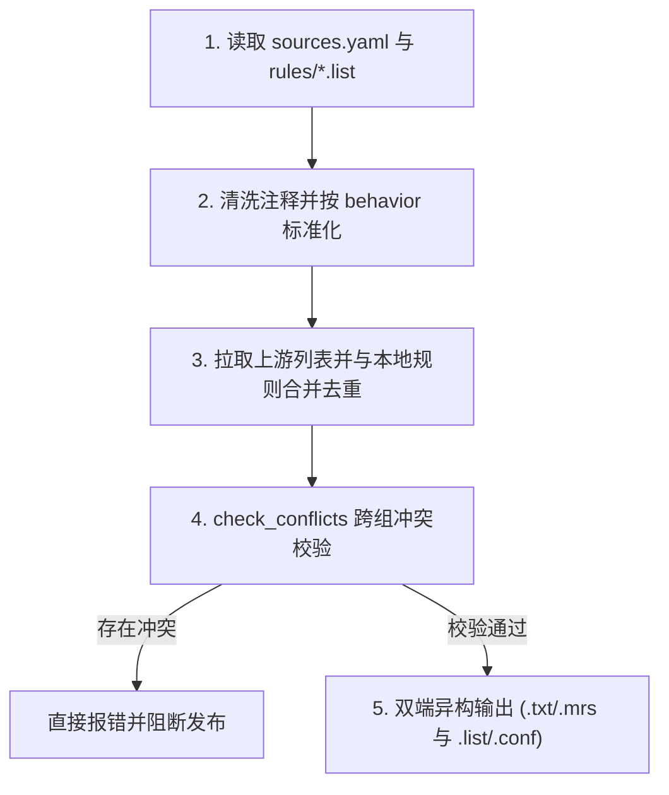
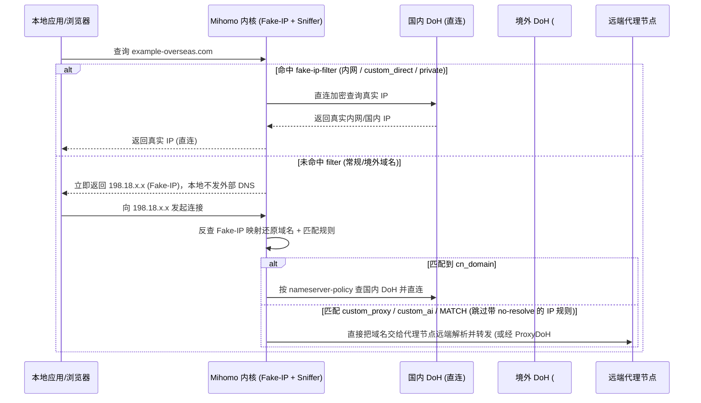
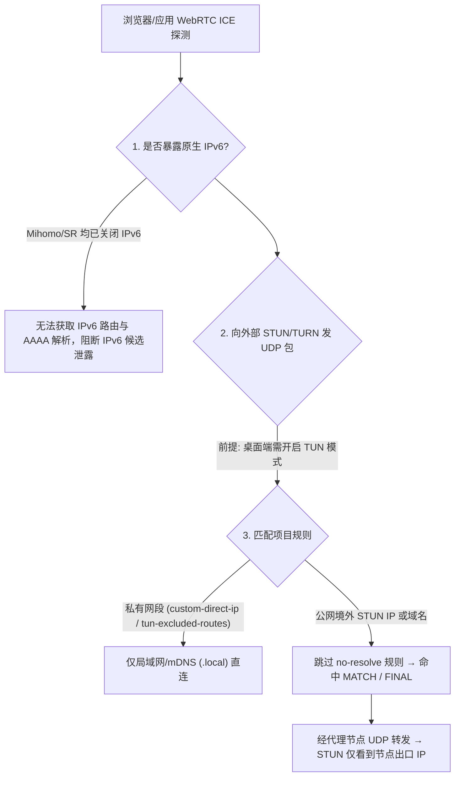

# Proxy Ruleset 核心原理：规则处理、DNS 防泄露与外部 RTC 防护机制

本文档深入解析 `proxy-ruleset` 仓库的底层运行原理，重点涵盖以下三部分：
1. **规则的处理机制**：单一规则源如何经过校验、聚合、去重、冲突检查与双端编译，最终在 Mihomo 与 Shadowrocket 客户端中按优先级执行。
2. **DNS 泄露（DNS Leak）的解决方案**：从 Fake-IP、四层 Nameserver 隔离、`respect-rules`、`no-resolve` 到嗅探与禁 IPv6 的全链路阻断原理。
3. **外部 RTC（WebRTC）泄露的应对原理与边界**：说明 WebRTC STUN/TURN 探测的泄露成因、本项目配置在 TUN 模式下如何阻断/代理外部 RTC 流量，以及非 TUN 模式与国内 STUN 等边界条件下的加固建议。

---

## 一、规则的处理机制（从源文件到客户端分流）

本项目的核心工程模式是 **「单一规则源（Single Source of Truth）+ 构建期严格校验 + 双端异构编译」**。维护者只需编辑 `rules/*.list` 与 `sources.yaml`，其余全部交由构建工具链 `scripts/build.py` 与 GitHub Actions（`.github/workflows/build.yml`）自动完成。

### 1.1 三层规则分层模型

客户端运行时的规则并非全部由本仓库重复编译，而是分为三层协同工作：

| 层级 | 来源 | 包含内容 | 处理方式 |
| :--- | :--- | :--- | :--- |
| **L1：本地静态规则** | `rules/*.list` | `custom-direct.list`、`custom-direct-ip.list`、`custom-proxy.list`、`custom-ai.list`、`custom-reject.list` | 人工直接维护，拥有最高决策权重，用于精准修复误杀或补充新域名 |
| **L2：外部聚合规则** | `sources.yaml` 中的 `bundles` | `custom-ai` 聚合上游 `MetaCubeX category-ai-!cn.list`；`private` 拉取上游 `MetaCubeX private.list` | 由 `scripts/build.py` 拉取、标准化、去重并编译到 `dist/` 分支 |
| **L3：上游基础大库** | 客户端直接引用的远程规则集 | **Mihomo**：直引 MetaCubeX `.mrs`（`private.mrs`、`geosite/cn.mrs`、`geoip/cn.mrs`）<br>**Shadowrocket**：轻量化 `DOMAIN-SET`（`Loyalsoldier/surge-rules` `direct.txt`）与内置 `GEOIP,CN` | 避免重复编译十万级基础规则；同时适配 iOS Network Extension 的低内存限制 |

### 1.2 构建期处理流水线（`scripts/build.py`）

执行 `python3 scripts/build.py`（或 CI 中的 `--require-mrs`）时，每条规则都会经历以下 5 个处理阶段：



#### （1）注释剥离与格式标准化（Normalization）
`parse_lines()` 会先用 `raw.split("#", 1)[0].strip()` 去除注释和空行，然后根据 `sources.yaml` 中定义的 `behavior` 分支处理：

- **`behavior: domain`（`normalize_domain_line`）**：
  - **支持的输入格式**：`DOMAIN-SUFFIX,`、`DOMAIN,`、`HOST-SUFFIX,`、`HOST,`、`+.domain`、`.domain` 以及裸域名（如 `example.com`）。
  - **语法约束**：统一转小写并校验不含空格或 `/`。**明确拒绝 `DOMAIN-KEYWORD` 等其他带逗号的规则类型**——因为 Mihomo 在编译 `domain` 行为的 `.mrs` 二进制规则集时，仅支持精确域名与后缀匹配，构建期提前拦截可防止运行时加载失败。
  - **双端输出映射**：
    - `DOMAIN-SUFFIX,foo.com` / `HOST-SUFFIX,foo.com` / `+.foo.com` → Mihomo 文本 `+.foo.com`，Shadowrocket `DOMAIN-SUFFIX,foo.com`
    - `DOMAIN,a.foo.com` / `HOST,a.foo.com` / 裸域名 `a.foo.com` → Mihomo 文本 `a.foo.com`，Shadowrocket `DOMAIN,a.foo.com`
    - `.foo.com` → Mihomo 文本 `.foo.com`，Shadowrocket `DOMAIN-SUFFIX,foo.com`
- **`behavior: ipcidr`（`normalize_ipcidr_line`）**：
  - **支持的输入格式**：`IP-CIDR,`、`IP-CIDR6,` 或裸 CIDR 字符串。
  - **规范化**：通过 Python 标准库 `ipaddress.ip_network(cidr_str, strict=False)` 计算规范网段（例如将 `192.168.1.5/24` 规范为 `192.168.1.0/24`），自动识别 IPv4 / IPv6。
  - **双端输出映射**：Mihomo 文本输出纯 CIDR（如 `192.168.1.0/24`）；Shadowrocket 输出自动强制附加 `no-resolve`（如 `IP-CIDR,192.168.1.0/24,no-resolve`、`IP-CIDR6,fe80::/10,no-resolve`）。

#### （2）合并去重（Merge & Deduplicate）
对每个 bundle，构建脚本先读取本地 `local` 文件，再拉取 `upstream` 列表（`--offline` 模式跳过网络拉取），使用字典 `seen.setdefault(m_rule, sr_rule)` 以 Mihomo 规范化键名去重，并按字典序排序输出，确保产物具备确定性（Deterministic）。

#### （3）跨组冲突阻断（`check_conflicts`）
构建期会执行严格的语义冲突检测，一旦发现同一域名同时存在于互斥策略组中，直接抛出 `RuntimeError` 阻断 CI：
- `custom-direct` 不允许与 `custom-proxy`、`custom-ai`、`custom-reject` 存在任何交集；
- `custom-reject` 不允许与 `custom-proxy`、`custom-ai` 存在任何交集。

#### （4）双端编译与分发（`.github/workflows/build.yml`）
- **Mihomo 端**：CI 下载最新官方 `mihomo` 二进制文件，执行 `mihomo convert-ruleset <behavior> text <txt> <mrs>`，将纯文本编译为二进制 `.mrs` 文件（`dist/mihomo/*.mrs`），加载速度快、内存占用极低。
- **Shadowrocket 端**：输出纯文本 `.list`（`dist/shadowrocket/*.list`）并连同 `templates/shadowrocket.conf` 一并发布。
- **自动发布**：每次 `master`/`main` 分支更新及每日 UTC 02:00（北京时间 10:00）定时任务构建后，强制推送产物到 `dist` 分支，客户端通过 `cdn.jsdelivr.net` 定期拉取热更新。

### 1.3 什么是 `.mrs` 格式？为什么 Mihomo 端选用它？

**`.mrs`**（Mihomo Rule-Set，自 Mihomo v1.18.7 起引入）是 Mihomo 内核专属的**二进制规则集格式**，用于替代传统的纯文本 `.yaml` / `.list` 规则集。

- **底层结构与性能优势**：
  - 文件以 `MRSv1` 为魔数头标识并采用 `zstd` 压缩，内部直接序列化了预构建好的**域名匹配树（Domain Trie）**或 **IPv4/IPv6 CIDR 匹配结构**。
  - 客户端下载后无需再像纯文本规则集那样逐行解析文本并现场重建索引，因此文件体积显著更小，加载速度可达毫秒级，同时内存占用更低。
- **使用限制与格式边界**：
  - **仅支持 `domain` 与 `ipcidr` 两种 `behavior`**：不支持 `classical` 规则（如 `DOMAIN-KEYWORD`、`DOMAIN-REGEX`、`PROCESS-NAME` 等），这也是 `scripts/build.py` 在构建阶段提前拦截不支持语法的直接原因。
  - **空集合限制**：`ipcidr` 类型的 `.mrs` 不允许为空（0 条规则在 Mihomo 加载时会报错），因此 `rules/custom-direct-ip.list` 至少需保留基础私有网段。
  - **内核专属**：`.mrs` 仅适用于 Mihomo（Clash.Meta）内核及其衍生客户端，与 sing-box 的 `.srs` 二进制规则集不互通。
- **编译与反编译命令**：
  - 可直接通过官方 `mihomo` 可执行文件在文本规则与 `.mrs` 之间互转：
    ```bash
    # 将纯文本编译为 .mrs（CI 构建流水线使用此方式）
    mihomo convert-ruleset <domain|ipcidr> text input.txt output.mrs

    # 将 .mrs 反编译回纯文本列表用于排查
    mihomo convert-ruleset <domain|ipcidr> mrs input.mrs output.list
    ```
  - 在配置中引用时，`rule-providers` 需显式指定 `format: mrs` 与对应的 `behavior`（`domain` 或 `ipcidr`）。

### 1.4 客户端运行时接入与规则匹配顺序

在运行时（`override/mihomo-override.js`、`templates/mihomo-base.yaml`、`templates/shadowrocket.conf`）：
1. **零节点命名假设与极简策略组**：Mihomo JS 覆写脚本仅通过正则 `INFO_NODE_RE` 过滤机场的流量/到期提示假节点，将剩余全量真实节点动态注入 `🚀 节点选择` 与 `🤖 AI 专用`（后者默认第 1 项跟随 `🚀 节点选择`），不依赖任何节点地区关键词；Shadowrocket 通过 `policy-regex-filter=.*` 实现同等效果。
2. **自上而下 First-Match 优先级链**：
   1. `custom_direct`（域名） → `🎯 全球直连` / `DIRECT`
   2. `custom_direct_ip`（IP/CIDR，`no-resolve`） → `🎯 全球直连` / `DIRECT`
   3. `private`（私有域名） → `🎯 全球直连` / `DIRECT`
   4. `custom_reject`（广告/遥测） → `🛑 广告拦截`（默认 `REJECT`，可手动切 `DIRECT`）
   5. `custom_ai`（AI 专用） → `🤖 AI 专用`
   6. `custom_proxy`（测漏站、GitHub、Telegram 等易误判境外站） → `🚀 节点选择` / `PROXY`
   7. `cn_domain`（Mihomo `cn.mrs` / Shadowrocket `DOMAIN-SET`） → `🎯 全球直连` / `DIRECT`
   8. `cn_ip`（Mihomo `geoip/cn.mrs` / Shadowrocket `GEOIP,CN`，**均带 `no-resolve`**） → `🎯 全球直连` / `DIRECT`
   9. `MATCH,🚀 节点选择` / `FINAL,PROXY`（所有未命中规则的未知流量默认走代理）

---

## 二、核心原理：如何解决 DNS 泄露（DNS Leak）

### 2.1 代理场景下 DNS 泄露的常见成因

DNS 泄露的本质是：**当用户访问境外站点时，域名解析请求没有通过代理隧道由境外可信 DNS 处理，而是直接发往了本地网络（如国内运营商 DNS）**。常见诱因有五类：
1. **规则匹配触发本地提前解析**：在域名尚未命中前面的规则时，如果后续遇到不带 `no-resolve` 的 `IP-CIDR` 或 `GEOIP,CN` 规则，内核会先在本地把域名解析成 IP 用来做 IP 段判断，直接造成 DNS 泄露。
2. **内核自身发送的上游 DNS 请求未走代理**：内核配置的境外 DoH/DNS 如果没有明确指定走代理出口或不受路由规则约束，查询报文会从本地网卡直接发出（不仅泄露，还可能被污染或阻断）。
3. **DoH 引导与回落泄露**：配置了加密 DoH 域名（如 `dns.alidns.com`）但没有纯 IP 引导服务器，或解析失败后回落到系统默认 DNS（即路由器/运营商 DNS）。
4. **IPv6 旁路泄露**：本地网络支持 IPv6 而代理未完全接管时，系统发起的 AAAA 查询或直连 IPv6 流量会绕过代理。
5. **应用硬编码 IP / 自带 DoH**：部分应用不走系统 DNS 直接连接裸 IP，绕过基于域名的分流规则。

### 2.2 Mihomo 端的组合防泄露设计

`override/mihomo-override.js` 与 `templates/mihomo-base.yaml` 采用以下五重机制联动阻断 DNS 泄露：



1. **`enhanced-mode: "fake-ip"`（`198.18.0.1/16`）切断本地真实解析**
   - 除了 `fake-ip-filter`（`+.lan`、`+.local`、`localhost.ptlogin2.qq.com`、`rule-set:private`、`rule-set:custom_direct`）放行真实 IP 给局域网设备与直连服务外，其余所有域名查询在内核层立刻返回 `198.18.0.1/16` 虚拟 IP。
   - 本机应用与浏览器拿不到真实境外 IP，也不会向本地运营商 DNS 发起查询；建立连接时，内核依据 Fake-IP 映射表还原原始域名，再按路由规则交由代理节点在远端完成解析。
2. **`respect-rules: true` + 四层隔离 Nameserver + `#策略组` 锚点**
   - `default-nameserver`（`223.5.5.5`、`119.29.29.29`）：仅配置纯 IP，专用于解析 DoH 服务器自身的域名（引导解析），防止出现“需要用 DoH 解析 DoH 域名”的死锁。
   - `proxy-server-nameserver`（`https://dns.alidns.com/dns-query`、`https://doh.pub/dns-query`）：专用于解析机场节点服务器的域名，确保代理隧道建立前不产生循环依赖。
   - `direct-nameserver`：国内加密 DoH，专供直连规则命中的域名使用。
   - `nameserver`：`https://cloudflare-dns.com/dns-query#🚀 节点选择` 与 `https://dns.google/dns-query#🚀 节点选择`。**关键在于显式附加 `#🚀 节点选择` 锚点并开启 `respect-rules: true`**，强制所有默认/未知域名的 DoH 解析请求必须穿过代理节点发出，彻底杜绝境内直连请求境外 DNS 或泄漏给本地 ISP。
   - `nameserver-policy` 与 `rule-providers` 严格联动：`private` / `custom_direct` / `cn_domain` 走国内 DoH；`custom_ai` 走带 `#🤖 AI 专用` 锚点的境外 DoH；`custom_proxy` 走带 `#🚀 节点选择` 锚点的境外 DoH。
3. **IP 类规则强制 `no-resolve`**
   - `RULE-SET,custom_direct_ip,🎯 全球直连,no-resolve` 与 `RULE-SET,cn_ip,🎯 全球直连,no-resolve` 均声明 `no-resolve`。当一个未知境外域名走完前面域名规则来到 `cn_ip` 时，内核不会为了判断归属而触发本地 DNS 解析，而是直接跳过并命中最后的 `MATCH,🚀 节点选择`，由远端代理节点完成解析。
4. **`sniffer` 域名嗅探补盲**
   - 开启 HTTP（80 / 8080-8880）、TLS（443 / 8443）与 QUIC（443 / 8443）嗅探，并启用 `force-dns-mapping: true`、`parse-pure-ip: true`、`override-destination: true`（仅跳过 `Mijia Cloud` 与 `+.push.apple.com`）。即使客户端自己内置 IP 直连，内核也能从握手包 SNI/Host 中恢复域名并重新走域名规则，防止绕过 DNS 分流。
5. **全局关闭 IPv6（`ipv6: false` 与 `dns.ipv6: false`）**
   - 阻止双栈网络下系统优先发起 AAAA 查询或通过本地原生 IPv6 出口泄露。

### 2.3 Shadowrocket（iOS 小火箭）端的防泄露设计

`templates/shadowrocket.conf` 针对 iOS 特性采取了对应的防护组合：
- **彻底禁用系统 DNS 回落**：设置 `dns-direct-system = false`、`dns-fallback-system = false` 与 `dns-direct-fallback-proxy = true`，防止直连解析失败或网络切换时静默回退到蜂窝/Wi-Fi 的运营商 DNS。
- **IP 化加密 DoH**：`dns-server = https://223.5.5.5/dns-query, https://doh.pub/dns-query`，`fallback-dns-server = https://1.1.1.1/dns-query`。主 DoH 直接使用 IP 形式（`223.5.5.5`）与 `1.1.1.1`，减少额外的域名引导查询。
- **禁用 IPv6**：`ipv6 = false`、`prefer-ipv6 = false`。
- **`no-resolve` + `FINAL,PROXY`**：所有域名规则前置，`custom-direct-ip.list` 与末尾 `GEOIP,CN,DIRECT,no-resolve` 全部加 `no-resolve`，未命中直连的未知域名直接落入 `FINAL,PROXY`，由远端节点完成 DNS 解析。

---

## 三、核心原理：如何应对外部 RTC（WebRTC）泄露

### 3.1 什么是外部 RTC 泄露，为什么普通代理容易在此失效？

现代浏览器与音视频客户端使用 WebRTC 建立点对点（P2P）媒体传输时，依赖 ICE（Interactive Connectivity Establishment）协议收集双方可用的网络地址候选（Candidates），其中包括：
1. **主机候选（Host Candidates）**：本机网卡上的地址（局域网 IPv4，以及如果存在的话——**运营商分配的原生公网 IPv6 地址**）。现代浏览器通常会用 mDNS（`.local`）隐藏内网 IPv4，但若存在原生公网 IPv6，往往会被直接采集。
2. **服务器反射候选（`srflx`，Server Reflexive Candidates）**：浏览器直接向外部 **STUN / TURN 服务器**（例如 `stun.l.google.com:19302`）发送 **UDP 探测包**，由外部 STUN 服务器告知客户端“你的公网出口 IP 和端口是多少”。

**传统代理在此泄露的三个典型路径**：
- **路径 A（绕过系统代理）**：Windows / macOS 的浏览器如果只配置了 HTTP / SOCKS5 系统代理，WebRTC 底层的 **UDP STUN 探测包通常不会走 HTTP 代理**，而是直接通过物理网卡向外发送 UDP 报文，导致外部 STUN 服务器与检测页面（如 `browserleaks.com/webrtc`、`ipleak.net`）直接看到用户的真实宽带公网 IP。
- **路径 B（IPv6 旁路泄露）**：即使 IPv4 走了代理隧道，若系统存在原生 IPv6 地址，WebRTC 依然可以收集公网 IPv6 候选或经 IPv6 UDP 直连外部 STUN 服务器。
- **路径 C（STUN 域名引发的伴随 DNS 泄露）**：如果连接域名形式的 STUN 服务器时在本地先做了 DNS 解析，就会同时暴露本地运营商 DNS。

### 3.2 本项目如何协同应对外部 RTC 泄露？

在理解机制前，必须先明确一个**关键工程前提**：
- **iOS 端（Shadowrocket）**：天然工作在 iOS `NEPacketTunnelProvider` 虚拟网卡（TUN）层，全局 TCP 与 UDP 流量默认都会进入小火箭隧道。
- **桌面 / Android 端（Mihomo）**：`override/mihomo-override.js` 与 `templates/mihomo-base.yaml` **刻意不硬编码覆盖 `tun` 配置段**（交由 Clash Party / FlClash / CMFA 客户端开关统一控制）。因此，**桌面端必须开启客户端的 TUN 模式（接管全局 UDP），且所选机场节点支持 UDP 转发**；如果仅开启 HTTP 系统代理，任何规则集都无法拦截浏览器直出的原生 UDP 报文。

在客户端以 **TUN 模式**（或 Shadowrocket）接管全局流量的前提下，本项目通过以下机制防止外部 RTC 泄露：



1. **彻底关闭 IPv6，消除原生公网 IPv6 候选与 IPv6 UDP 直出**
   - Mihomo 端显式配置 `ipv6: false` 与 `dns.ipv6: false`；Shadowrocket 端显式配置 `ipv6 = false` 与 `prefer-ipv6 = false`。
   - 这样既不会解析出外部 STUN 服务器的 IPv6 地址，也避免本地原生 IPv6 地址被 WebRTC 当作可用候选暴露或绕过 IPv4 代理隧道。
2. **外部 STUN/TURN 探测流量全量走代理出口（不直连）**
   - **当 WebRTC 连接公网裸 IP 形式的外部 STUN 服务器时**：项目的直连 IP 规则 `rules/custom-direct-ip.list` 仅放行标准的私有/保留网段（`10.0.0.0/8`、`100.64.0.0/10`、`127.0.0.0/8`、`169.254.0.0/16`、`172.16.0.0/12`、`192.168.0.0/16`、`::1/128`、`fc00::/7`、`fe80::/10`），`cn_ip` / `GEOIP,CN` 仅放行中国大陆 IP。因此所有海外公网 STUN 服务器的 UDP 报文都会穿透直连规则，最终命中兜底规则 `MATCH,🚀 节点选择`（Mihomo）或 `FINAL,PROXY`（Shadowrocket），经代理节点 UDP 转发出去。此时外部 STUN 返回并展示给网页的反射公网 IP 是**代理节点的出口 IP**，而非用户真实宽带 IP。
   - **当 WebRTC 连接域名形式的外部 STUN 服务器时**：在 `fake-ip`、`proxyDoH`、`dns-direct-system = false` 以及 `no-resolve` 的联合保护下，解析过程同样不会泄露给本地运营商 DNS，最终连接也经代理节点完成。
3. **局域网与 mDNS 隐私隔离**
   - Shadowrocket 通过 `skip-proxy` 与 `tun-excluded-routes` 放行局域网保留网段；Mihomo 通过 `fake-ip-filter` 放行 `+.lan`、`+.local` 与 `rule-set:private`，保证浏览器用 mDNS（`.local`）替代真实内网 IP 时能够正常工作，同时不会把公网 UDP 探测放行到直连路由。
4. **测漏站点强制走代理闭环**
   - `rules/custom-proxy.list` 内置 `browserleaks.com`、`ipleak.net`、`whoer.net`、`dnsleaktest.com` 等常见测漏站点，确保访问测漏页与页面内置脚本通信本身均强制经 `🚀 节点选择` / `PROXY` 出口。

### 3.3 外部 RTC 防护的工程边界与可选加固建议

为保持技术表述的严谨性，需注意以下实际边界（在 `README.md` 与 `ARCHITECTURE.md` 中建议的测漏自检同样基于这些前提）：

| 边界场景 | 现状说明 | 可选加固方式 |
| :--- | :--- | :--- |
| **桌面端未开 TUN 模式（仅开系统代理）** | 浏览器 WebRTC UDP STUN 包不经过 HTTP/SOCKS 代理端口，会直连公网泄露真实 IP | 在 Clash Party / FlClash 中**务必开启 TUN 模式** |
| **机场节点不支持 UDP 转发** | 若节点丢弃 UDP 或客户端自动回落，外部 STUN 探测可能超时或出现异常行为 | 选用支持 UDP 的节点，或在浏览器禁用非代理 UDP |
| **网页指定国内 STUN 服务器** | 本项目 `custom-reject.list` 目前未拦截 STUN 域名或 `3478`/`19302` 端口；若对端使用国内 IP 的 STUN，会命中 `cn_ip` / `GEOIP,CN` 走 `DIRECT` | 如需“零暴露”（连国内 STUN 也禁止），可在浏览器限制 WebRTC（如关闭 `WebRTC IP Handling` / 安装防泄露扩展）或在 `custom-reject.list` 中补充屏蔽常见 STUN 域名 |

---

## 四、总结

`proxy-ruleset` 通过 **“构建期严格标准化与冲突检测 + 运行时零节点假设的 4 策略组 + Fake-IP / 四层 DoH / `no-resolve` / Sniffer / 禁 IPv6”**，在换机场订阅零改动的条件下，将所有本应走代理的域名解析与外部网络连接统一收口到代理隧道中：
- **对规则**：单一源维护、CI 自动校验去重编译为 `.mrs` 与轻量 `.list`，兼顾桌面端高性能与 iOS 端低内存。
- **对 DNS 泄露**：通过 Fake-IP 隔离、境外 DoH 显式绑定 `#策略组`、禁止系统 DNS 回落与 `no-resolve` 阻断提前解析，实现全链路不接触本地运营商 DNS。
- **对外部 RTC 泄露**：在 TUN 全局接管（含 Shadowrocket）的前提下，通过禁用 IPv6、仅放行私有网段、未知公网 UDP 兜底走代理节点转发，避免真实宽带 IPv4/IPv6 通过 STUN 探测泄露。
